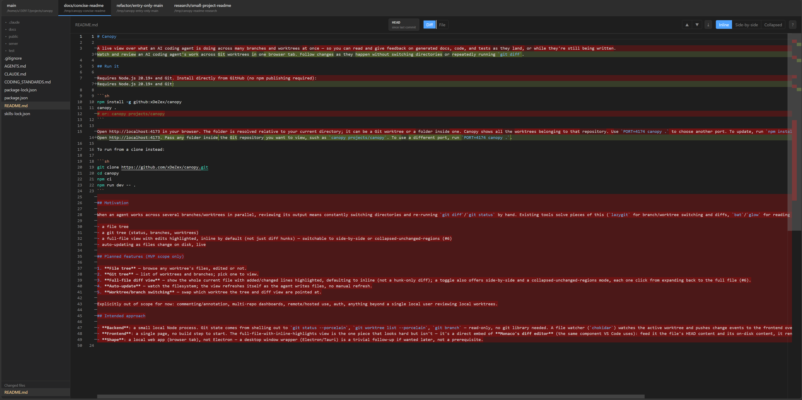

# Canopy

Watch and review an AI coding agent's work across Git worktrees in one browser tab. Follow changes as they happen without switching directories or repeatedly running `git diff`.



## Run it

Requires Node.js 20.19+ and Git:

```sh
npm pack github:xDeZex/canopy
npm install -g --omit=dev ./canopy-0.1.0.tgz
canopy .
```

Use the tarball filename printed by `npm pack` if the version changes. Packing
from GitHub compiles during npm's `prepare` lifecycle. Keep lifecycle scripts
enabled and do not omit development dependencies during source preparation:
npm obtains the locked development build tools for that step. The subsequent
tarball install supports `--omit=dev`; the installed CLI runs ordinary JavaScript
from `dist/`, with no TypeScript loader or bundler, build tools, source or tests.

The two steps are intentional: npm 10.8.2 (bundled with Node 20.19.0) fails a
direct `npm install -g github:xDeZex/canopy`, even without `--omit=dev`, because
its Git preparation subprocess inherits global installation configuration and
does not install the build tools into its temporary clone. Packing from Git
first avoids that upstream lifecycle limitation without putting TypeScript in
runtime dependencies. A source clone likewise needs development dependencies
for `npm ci`; production-only omission is supported for the compiled tarball,
not for preparing source.

Open http://localhost:4173. Pass any folder inside the Git repository you want to view, such as `canopy projects/canopy`. To use a different port, run `PORT=4174 canopy .`.

To run from a clone instead:

```sh
git clone https://github.com/xDeZex/canopy.git
cd canopy
npm ci
npm run dev -- .
```

`npm ci` prepares compiled output, and `npm run dev` clean-rebuilds before
starting it. After editing source, restart `npm run dev`; there is no added
development watcher. Native browser modules retain their `.js` imports.

## Read GitHub issues

Use the toolbar's **Code / Issues** toggle, or press `i`, to read the repository's
open issues alongside your work. Issues uses the GitHub CLI (`gh`) and its existing
login; Code view does not require it. The source host and repository are displayed,
and multiple repository remotes require an explicit choice.

In Issues, `s` / `f` select the previous / next issue (wrapping at either end),
and `e` / `d` scroll the conversation. Shortcuts are suppressed while typing.
The list and conversation refresh when entering Issues or pressing **Refresh**;
there is no background polling. Selection is shared across worktrees, and switching
views keeps your reading place. Failed refreshes retain previously loaded content.
Use **Open in GitHub** to act on an issue: Canopy's Issues view is read-only.

## Development checks

```sh
npm run typecheck
npm test
npm run smoke:build
npm run smoke:package
```

Tests compile first and select only explicit `dist/test/**/*.test.js` files,
never simultaneous source/output discovery. GitHub Issues tests use deterministic
injected CLI/API responses: they do not require `gh`, authentication, GitHub access,
or a real repository with issues. The smoke checks are separate IO
checks requiring Git and, for packaging, npm registry access. See
[TypeScript migration and confidence boundaries](docs/typescript-migration.md)
for the temporary JavaScript manifest and Git-source installation check.

Review conversations support inline user replies, including reopening resolved
threads. See the [reply/reopen and incoming-conflict demo](docs/reply-demo.md) for
a user-run visual and keyboard evaluation.
